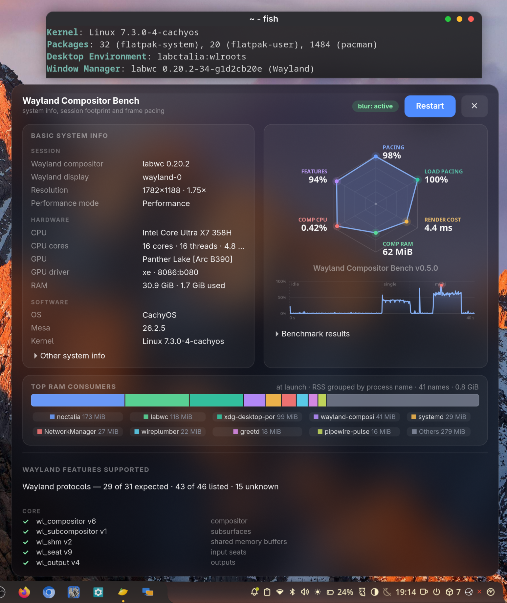

# Labctalia

A minimal **labwc + Noctalia** Wayland session for Arch Linux. It is the
labwc port of [Cosmalia](https://github.com/grigio/cosmalia-session): the
compositor is [labwc](https://labwc.github.io/), the shell is
[Noctalia](https://github.com/noctalia-dev/noctalia), and the session starts
everything through systemd user units instead of a labwc autostart file.



The package installs:

- `/usr/bin/labctalia-session` — the session launcher;
- `/usr/share/wayland-sessions/labctalia.desktop` — the XDG session entry;
- `/usr/lib/systemd/user/labctalia-session.target` and the
  `labctalia-noctalia.service` unit;
- optional `labctalia-theme-sync.path/.service` and
  `labctalia-gestures.service` units;
- `/usr/share/xdg-desktop-portal/labctalia-portals.conf` — explicit portal
  backend selection (wlr for screenshots/screencast, gtk for the desktop UI,
  gnome-keyring for secrets);
- `/etc/xdg/labwc/rc.xml` and `/etc/xdg/labwc/menu.xml` — labwc defaults;
- `/usr/share/themes/macos-dark/labwc/` — the MIT-licensed `macos-dark` theme;
- `/usr/bin/labctalia-session-default` — the optional gtkgreet helper.

The package **does not** edit `/etc/greetd`, **does not** install
`~/.config/labwc/autostart`, and **does not** make itself the default session.
It can be installed alongside `cosmalia-session`.

## Requirements

Install the package (or use the source install below). The hard dependencies
are `labwc`, `noctalia`, `xdg-desktop-portal-wlr`, `xdg-desktop-portal-gtk`,
`grim`, `slurp`, `polkit`, `gnome-keyring` and `wireplumber`.

`labwc-blur` is recommended: it provides the same `labwc` binary plus
`ext-background-effect-v1`, which the default `rc.xml`'s `<blur>` block uses.
Stock labwc still works; it ignores the block with a warning.

Useful optional packages:

| Package | Why |
| --- | --- |
| `satty` | annotate screenshots from the Print key |
| `wl-clipboard` | copy screenshots when `satty` is absent |
| `ttf-inter` | the font used by the `macos-dark` theme |
| `brightnessctl` | brightness keys |
| `playerctl` | media keys |
| `python`, `wtype`, `libinput` | 4-finger gesture helper |
| `kanshi` | dynamic display profiles |
| `polkit-gnome` | fallback polkit agent if Noctalia's is disabled |
| `xorg-xwayland` | X11 apps (the default `rc.xml` sets `xwayland` to `no`) |
| `gvfs` | trash, recent files and volume monitoring in file choosers |

## Install

### Package

```sh
git clone https://github.com/grigio/labctalia-session
cd labctalia-session
makepkg -fi
```

Or install a release package:

```sh
sudo pacman -U labctalia-session-*.pkg.tar.zst
```

The package does not touch `/etc/greetd` or `~/.config/labwc`.

### From a checkout without pacman

```sh
./scripts/install.sh             # session files only
./scripts/install.sh --default   # ... and make it the gtkgreet default
```

`scripts/install.sh` refuses to run if the package is already installed (so
pacman's file list stays correct).

## Start the session

Log out and pick **Labctalia** in your greeter. Greeters that read
`/usr/share/wayland-sessions` (GDM, SDDM, Noctalia Greeter) list it
automatically.

`gtkgreet` only lists `/etc/greetd/environments` plus its `-c` argument. Add
Labctalia to the dropdown without changing the default:

```sh
sudo labctalia-session-default --list
```

Make it the gtkgreet default (`-c`, or the first line of `environments` when
`gtkgreet` has no `-c`):

```sh
sudo labctalia-session-default
```

With Noctalia Greeter, pick **Labctalia** once, or set:

```toml
[session]
default = "Labctalia"
```

in `/var/lib/noctalia-greeter/greeter.toml`.

greetd reads its configuration once at startup; the change lands at the next
greetd start (a reboot, or `systemctl restart greetd` while logged out).

## How startup works

There is no `~/.config/labwc/autostart` in this package. The launcher owns the
startup order:

1. Set `XDG_SESSION_TYPE=wayland`, `XDG_SESSION_DESKTOP=labctalia`,
   `DESKTOP_SESSION=labctalia` and `XDG_CURRENT_DESKTOP=labctalia:wlroots`.
2. Stop a stale `graphical-session.target` and the COSMIC portal from a
   previous session.
3. Start `/usr/bin/labwc` and find the `wayland-N` socket it listens on.
4. Export `WAYLAND_DISPLAY` and `LABWC_PID` to the systemd user manager and
   the D-Bus activation environment.
5. Restart `xdg-desktop-portal.service` and `xdg-desktop-portal-wlr.service`
   so they see the new socket.
6. Start `labctalia-session.target`, which pulls in
   `labctalia-noctalia.service`.
7. On exit, stop the target, the wlr portal and the graphical session.

`LABWC_PID` matters: Noctalia uses it for compositor detection and logout, and
`labwc --reconfigure` needs it. Noctalia is a systemd service, not a child of
labwc, so the launcher publishes the variable explicitly.

The optional helpers are **not** started unless you enable them:

```sh
systemctl --user enable --now labctalia-theme-sync.path
systemctl --user enable --now labctalia-gestures.service
```

They are `WantedBy=labctalia-session.target`, so they only run in this session,
not in Cosmalia or another labwc session.

## Migrating an existing labwc setup

The package does not edit your personal labwc configuration. If you already
have one, clean up these two files and any personal units so the session's
units are the only owners of the services.

### `~/.config/labwc/environment`

Remove `XDG_CURRENT_DESKTOP` (the launcher exports
`labctalia:wlroots`), or set it to the same value:

```sh
XDG_CURRENT_DESKTOP=labctalia:wlroots
```

labwc reads this file itself and overrides the launcher's environment. A stale
`XDG_CURRENT_DESKTOP=labwc:wlroots` makes labwc's children and the systemd
user manager disagree, which can make `xdg-desktop-portal` pick the wrong
backend. The launcher logs a warning when it sees the mismatch.

### `~/.config/labwc/autostart`

Remove lines that start any of these; `labctalia-session.target` starts them:

- `noctalia` / `noctalia --daemon`
- `noctalia-labwc-theme-sync` / `labctalia-theme-sync`
- `labwc-4finger-gestures` / `labctalia-gestures`
- `xdg-desktop-portal`, `xdg-desktop-portal-wlr`, `xdg-desktop-portal-gtk`
- `labwc-session.target`

Keep personal app launches if you want them. If you prefer to keep the file
mostly intact, guard only the managed lines:

```sh
if [ -z "${LABCTALIA_SESSION:-}" ]; then
  noctalia --daemon &
  ...
fi
```

The launcher sets `LABCTALIA_SESSION=1` for exactly this purpose. Do **not**
start Noctalia from the autostart under Labctalia: the systemd unit is what
gets `LABWC_PID`, restart-on-crash and `PartOf=labctalia-session.target`.

### Old personal systemd units

Autostart is not the only place an old setup can start the same services. If
you moved Noctalia, theme sync or gestures to personal units, disable those
too: they are not namespaced. The path unit is usually
`WantedBy=default.target` and runs in every session; the gesture unit may be
pulled in by `labwc-session.target`.

```sh
systemctl --user disable --now noctalia-labwc-sync.path
systemctl --user disable --now labwc-4finger-gestures.service
systemctl --user daemon-reload
```

Then enable the Labctalia equivalents you want:

```sh
systemctl --user enable --now labctalia-theme-sync.path
systemctl --user enable --now labctalia-gestures.service
```

Once the new units work, you can delete
`~/.config/systemd/user/noctalia-labwc-sync.*` and
`~/.config/systemd/user/labwc-4finger-gestures.service`. The package does not
remove personal units.

## labwc configuration and theme

labwc reads `~/.config/labwc/rc.xml` before `/etc/xdg/labwc/rc.xml`. The
package's file is only a default. To customise it:

```sh
mkdir -p ~/.config/labwc
cp /etc/xdg/labwc/rc.xml ~/.config/labwc/rc.xml
cp /etc/xdg/labwc/menu.xml ~/.config/labwc/menu.xml
# edit, then reload:
labwc --reconfigure
```

The default uses the `macos-dark` theme from
`/usr/share/themes/macos-dark/labwc/`. A theme in
`~/.local/share/themes/macos-dark` shadows the packaged one; remove or update
it if the titlebar looks different from the screenshots.

The default keybinds:

| Key | Action |
| --- | --- |
| `W-Return` | terminal (`lab-sensible-terminal`) |
| `W-Space` | Noctalia launcher |
| `W-S-w` | Noctalia session panel |
| `W-Escape`, `XF86PowerOff` | lock and suspend |
| `W-w` | close window |
| `W-Up` / `W-Down` | toggle maximize |
| `W-S-Left` / `W-S-Right` | send window to desktop |
| `C-W-Left` / `C-W-Right` | previous / next desktop |
| `W-1` … `W-4` | go to desktop |
| `W-A-r` | reconfigure labwc |
| `Print` | `labctalia-screenshot` |
| `XF86Audio*` | volume / mute / play-pause |
| `XF86MonBrightness*` | brightness (3% steps) |

Right-clicking the desktop opens the root menu from `menu.xml`.

## Portals

`XDG_CURRENT_DESKTOP=labctalia:wlroots` makes xdg-desktop-portal read
`/usr/share/xdg-desktop-portal/labctalia-portals.conf`. It selects:

- `wlr` for `Screenshot` and `ScreenCast` (wlr-screencopy + PipeWire);
- `gtk` for `FileChooser`, `Settings`, `Access`, `Print`, `Notification`,
  `AppChooser` and the rest of the desktop UI;
- `gnome-keyring` for `Secret`;
- `Inhibit=none`, matching labwc's own portal configuration (the gtk
  inhibitor expects a GNOME session manager).

The explicit list avoids `default=wlr;*` falling through to the COSMIC portal
for `FileChooser`/`Settings` on systems where `xdg-desktop-portal-cosmic` is
installed. It also avoids routing `Settings`/`Clipboard` to the GNOME portal,
which needs Mutter.

The launcher restarts the portal after the compositor socket exists.
`xdg-desktop-portal-gtk` is D-Bus activated on first use. If you have a
personal `~/.config/xdg-desktop-portal/portals.conf` or a
`~/.config/xdg-desktop-portal/labwc-portals.conf` that routes interfaces to
`cosmic` or `gnome`, remove it or make it match the selection above.

## Optional: Noctalia theme sync

The static `macos-dark` theme is the default. To make the window decorations
follow Noctalia's active colors:

```sh
systemctl --user enable --now labctalia-theme-sync.path
```

The path unit watches `~/.local/state/noctalia/settings.toml` and
`~/.config/noctalia/colors.json`, then runs `labctalia-theme-sync`. The script
first asks Noctalia to render its templates; if that is unavailable it reads
`colors.json` and writes `~/.config/labwc/themerc-override` itself. It reloads
labwc when `LABWC_PID` is present.

To use Noctalia's template instead of the fallback, add this to
`~/.config/noctalia/config.toml` (the package does not edit it):

```toml
[theme.templates.user.labwc-theme]
input_path = "~/.config/noctalia/templates/labwc.conf"
output_path = "~/.config/labwc/themerc-override"
post_hook = "/usr/bin/labctalia-theme-reload"
```

`labctalia-theme-reload` is a no-op outside labwc and runs
`labwc --reconfigure` inside it. The sync log is
`~/.local/state/labctalia/theme-sync.log`.

## Optional: 4-finger touchpad gestures

The helper maps a 4-finger horizontal or vertical swipe to
`Ctrl+Super+Left/Right` (previous/next desktop). It needs read access to the
input devices, `wtype` and `libinput`:

```sh
sudo usermod -aG input "$USER"
# log out and back in so the group is active
systemctl --user enable --now labctalia-gestures.service
```

Check it with:

```sh
systemctl --user status labctalia-gestures.service
journalctl --user -u labctalia-gestures.service -f
libinput debug-events      # should print events, not a permission error
```

The threshold and cooldown can be changed with a drop-in:

```sh
systemctl --user edit labctalia-gestures.service
```

```ini
[Service]
Environment=LABWC_GESTURE_THRESHOLD=90
Environment=LABWC_GESTURE_COOLDOWN=0.8
```

## Screenshots

`Print` runs `labctalia-screenshot`:

1. `slurp` selects a region (cancelling exits quietly);
2. `grim` saves it under `${XDG_PICTURES_DIR:-$HOME/Pictures}`;
3. `satty` opens it if installed (Enter copies the annotated image);
4. otherwise, `wl-copy` copies the PNG when available.

`grim` and `slurp` are dependencies; `satty` and `wl-clipboard` are optional.

## Coexistence with Cosmalia

`cosmalia-session` and `labctalia-session` can be installed together. The
launcher, session entry, units, portal config and helper are all namespaced
with `labctalia-`. The package does not add a `conflicts`/`replaces` entry and
does not remove Cosmalia from `/etc/greetd/environments`.

`labctalia-session-default --list` only appends the Labctalia entry; it leaves
the Cosmalia entry and the current default alone. `labctalia-session-default`
changes the gtkgreet default but still does not remove other sessions.

## Troubleshooting

### labwc does not start / black screen

```sh
cat "$XDG_RUNTIME_DIR/labctalia-session.log"
journalctl --user -b
```

Check that `/usr/bin/labwc` and `/usr/bin/noctalia` exist and are executable.
The launcher is the session leader: do not run it from a terminal inside an
existing graphical session, because it stops `graphical-session.target` as
part of startup. For a nested test, use a separate user manager or VM and set
`LABCTALIA_NESTED=1` to keep `DISPLAY`/`WAYLAND_DISPLAY`; without it the
launcher clears them so labwc takes the DRM/KMS backend.

### Noctalia is not running

```sh
systemctl --user status labctalia-noctalia.service
journalctl --user -u labctalia-noctalia.service -b
```

The target pulls the service in; do not enable `labctalia-noctalia.service`
separately. If you removed the package's units, `systemctl --user
daemon-reload` and log in again.

### Logout or reconfigure does nothing

```sh
systemctl --user show-environment | grep -E 'LABWC_PID|WAYLAND_DISPLAY'
```

`LABWC_PID` must point at the running labwc. If it is missing, Noctalia was
probably started from `~/.config/labwc/autostart` instead of the systemd unit.
Remove that line. `W-A-r` runs `labwc --reconfigure` from a labwc child, so it
has the variable; the theme sync also needs the imported value.

### Screenshots or screen sharing fail

```sh
systemctl --user status xdg-desktop-portal.service xdg-desktop-portal-wlr.service
journalctl --user -u xdg-desktop-portal -u xdg-desktop-portal-wlr -b
busctl --user introspect org.freedesktop.portal.Desktop \
  /org/freedesktop/portal/desktop
```

Check `XDG_CURRENT_DESKTOP` is `labctalia:wlroots` (not `labwc:wlroots` from a
stale `~/.config/labwc/environment`), and that
`/usr/share/xdg-desktop-portal/labctalia-portals.conf` exists. Remove personal
portal overrides that select `cosmic` or `gnome`.

### Gestures do not work

The service logs `libinput exited` when the user cannot read the input
devices. Add the user to the `input` group and start a new login session.
`wtype` must be installed; the service has `ConditionPathExists` for
`/usr/bin/wtype`, `/usr/bin/libinput` and `/usr/bin/python3`.

### The window decorations look wrong

The static theme is `/usr/share/themes/macos-dark/labwc/`. A personal
`~/.local/share/themes/macos-dark` wins over it. If theme sync is enabled, it
writes `~/.config/labwc/themerc-override`, which is layered on top of the
theme. Reload with `W-A-r` or `labwc --reconfigure`.

## Uninstall

Disable the optional units first so no dangling symlinks remain:

```sh
systemctl --user disable --now labctalia-theme-sync.path
systemctl --user disable --now labctalia-gestures.service
sudo pacman -R labctalia-session
```

The package does not change `/etc/greetd`; if Labctalia is the greeter
default, point the greeter at another session first. Your personal
`~/.config/labwc` files and `themerc-override` are left in place.

## License

MIT. The bundled `macos-dark` theme is also MIT; see
`/usr/share/licenses/labctalia-session/LICENSE` and
`/usr/share/licenses/labctalia-session/LICENSE.macos-dark-theme`.
